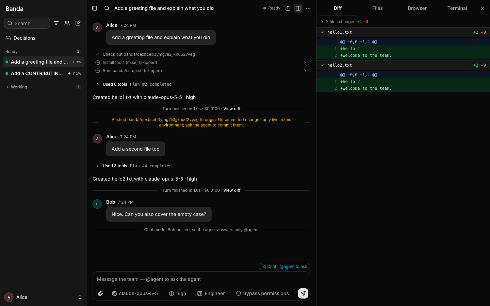
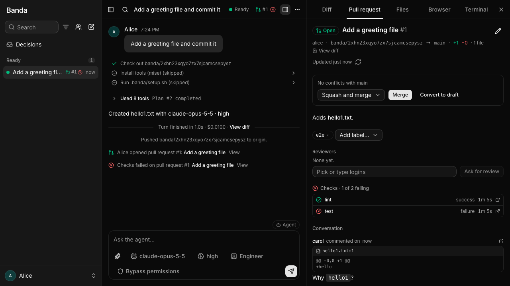

# Banda

Banda is a web app where a team builds software together with coding agents. Every piece of work is a **thread**: one owner, one [Claude Code](https://code.claude.com) agent and one isolated Kubernetes sandbox with the repository checked out on its own branch. Teammates see each other's threads live, post into them, mention each other, review diffs, fork a thread to try another way and hand work over. Agents see each other too, through Banda's MCP server.

It is built for one team that trusts each other, on a cluster that team runs. Why it exists and how it decides is in [VISION.md](VISION.md).



## What it does

- **One sandbox per thread.** Each thread gets its own pod with the repo on branch `banda/<id>`, the repo's tools from `mise.toml` and its `.banda/setup.sh`. It sleeps after 30 minutes idle and wakes on the next message.
- **Each person's own Claude.** The unmodified `claude` CLI runs in the sandbox. Each user logs in once with their own subscription (or an API key); Banda never sees the credential.
- **Multiplayer.** Everyone reads every thread. On a subscription only you run your agent, and teammates suggest prompts you can use as a draft; on an API key, or in a thread you run on the team's Console account, their requests become cards you approve, unless you trust them. @mentions, chat mode, presence, a team board and a morning brief.
- **Control.** Permission modes (bypass, ask, accept edits, plan) with approval cards, "always allow" rules and the agent's questions as votes. One `/decisions` page for everything waiting on you.
- **Never losing work.** Auto-push after every turn, a push before every suspend, and nothing deleted that isn't on origin.
- **GitHub and GitLab.** Open, review and merge pull and merge requests from the thread, with checks, reviews and the conversation in a tab. The agent reads failing checks and review comments.
- **Forks, races and sub-threads.** Try a prompt 2–4 ways and compare side by side; split work into sub-threads. Agents can spawn and read threads, with limits.
- **Look, don't edit.** The right pane shows the diff (with line comments), the files, a terminal and a browser on the app running in the sandbox.
- **Profiles** for people who aren't engineers: Specification, DevOps and Business change how the agent talks and works, not what it may do.



## Try it on your machine

You need [mise](https://mise.jdx.dev) and either Podman (macOS: `podman machine init --cpus 8 --memory 16384 && podman machine start`) or Docker. Banda creates a [kind](https://kind.sigs.k8s.io) cluster for the sandboxes, Postgres and a local sign-in provider ([Dex](https://dexidp.io)).

```sh
git clone https://github.com/jhoogstraat/banda && cd banda
mise trust && mise install
mise run up
```

The first `up` creates the cluster and builds the sandbox image, which takes several minutes. It then prints a URL (your LAN address; `PUBLIC_HOST=localhost mise run up` keeps it on this machine).

1. Open the URL and sign in as `alice@example.com` with password `password` (`bob` and `carol` exist too, for trying it as a team).
2. Create a thread: type a prompt and pick a repository (or **No repository**).
3. The first thread says "Claude Code is not logged in". Click **Log in to Claude Code**, open the URL shown in the terminal, sign in with your Claude subscription and paste the code back. Your login is kept and shared by all your threads.
4. For private repositories, auto-push and pull requests, set up the GitHub App or a GitLab application in Settings and connect your account ([docs/usage.md](docs/usage.md#the-github-app)), or add a `GIT_TOKEN` secret (scopes there too).

`mise run down` stops it; `mise run up` again restarts it. With Docker instead of Podman, see [docs/development.md](docs/development.md#prerequisites).

## Deploy it for your team

Banda needs a Kubernetes cluster whose CNI enforces NetworkPolicy, the [agent-sandbox](https://github.com/kubernetes-sigs/agent-sandbox) controller and an OIDC provider, and whoever runs it agrees to Anthropic's Commercial Terms, which running Claude Code in hosted sandboxes requires; in the EEA and Switzerland, people log in with Team or Enterprise seats or API keys, not Pro, Max or Ultra. A Claude Team plan with a linked Console organization fits best: it covers all of this, and its seats include API credits for threads on the team's account ([configuration](docs/configuration.md#team-console-identity)). Each release publishes multi-arch images and a Helm chart to GHCR.

```sh
kubectl apply -f https://github.com/kubernetes-sigs/agent-sandbox/releases/download/v1.0.8/sandbox.yaml
helm install banda oci://ghcr.io/jhoogstraat/charts/banda -n banda --create-namespace \
  --set ingress.enabled=true,ingress.className=nginx,ingress.host=banda.example.com,ingress.previewHost=preview.banda.example.com,ingress.tlsSecret=banda-tls \
  --set oidc.issuer=https://login.example.com,oidc.clientSecret=... --set podCIDR=10.42.0.0/16
```

Step by step, with what to have ready (an ingress class, the pod network, TLS) and a bundled Dex instead of a provider: [docs/deployment.md, "Install"](docs/deployment.md#install).

| Option | For |
|---|---|
| **Helm chart** (`deploy/helm/banda`, `oci://ghcr.io/jhoogstraat/charts/banda`) | The default: everything that differs between clusters is a value. Bundled or external Postgres, your OIDC provider or a bundled Dex. |
| **Kustomize** (`deploy/kustomize/`) | People who prefer patching. The base inflates the same chart; `example` patches it for a real cluster, `kind` is the local install. |
| **Release manifest** (`banda.yaml` on every GitHub release) | `kubectl apply -f` with neither tool. |

There is no Compose file and no operator: sandboxes are Kubernetes objects, so Banda needs a cluster in any case, and the API already reconciles them. [docs/deployment.md](docs/deployment.md) has the full install, the reasoning behind these options and what to check before a team relies on it (Postgres backups, multi-node volumes, sizes).

## Before you run it for others

- **Claude's terms.** Banda follows them as we read them, and takes the strict reading where they are unclear:
  - **Hosting.** Running Claude Code in hosted sandboxes "requires agreeing to our Commercial Terms of Service", the binary "must not be modified", and each end user authenticates with their own credentials and pays for their own usage. So whoever runs Banda agrees to those terms, which Banda can't check. It runs the published binary as it is and never pays for or resells usage.
  - **Sign-in.** The terms say "sign-in to a Claude account must complete through Anthropic's own flow", and that developers "may not collect, store, or intermediate Claude.ai credentials or session tokens". Each person runs the binary's own `claude auth login` and signs in on claude.ai in their own browser. The code they paste back passes through Banda's terminal stream to the binary, and Banda neither logs nor stores it. The terms don't say whether that one-time code counts as a credential. It is the closest call here.
  - **The login volume.** The binary keeps the login on that person's volume, which only their own pods mount and the API never does. Anthropic documents the same mechanism for dev containers ("mount a named volume at `~/.claude`"), but not for a hosted platform.
  - **One person per subscription.** The Consumer Terms forbid making "your Account available to anyone else". On a Team or Enterprise seat "only that person may use it", and Team users "can't route their work through another user's account". From 2026-11-12 the Usage Policy also names "services that route requests through consumer subscriptions". So on a subscription only the thread's owner starts turns, and a teammate's own work belongs in a fork, on their own login.
  - **Suggested prompts.** On a subscription, a teammate's `@agent` post is a suggestion that never reaches the agent by itself, not even as context. The owner can **Use as draft**, edit it and send it from their own composer. That makes it their own input ("You are responsible for all Inputs you submit"), and nothing sends someone else's post as it is. Banda can't tell a teammate steering the owner's work from a teammate getting their own work done this way. The second is what the seat rule forbids, so it stays the team's to avoid.
  - **Teammates' turns.** The terms allow an API key "for use by the customer's own authorized users", billed to the key owner. So a teammate's request runs only on an API key or the team's Console identity: as a card the owner approves, or directly in a thread they trust. Those pods get a Claude volume of their own without the owner's login, and their agents start no turn on a subscription. Use the team's Console account, because a person's private key has the same problem as their subscription.
  - **The Agent SDK.** Banda keeps the unmodified binary rather than the SDK: the permission above names that binary, while products on the SDK "should use API key authentication", and third parties may not offer claude.ai login "unless previously approved". That other products use the SDK with Claude plans says nothing about what they agreed with Anthropic.
  - **Agents.** Plans still cover `claude -p`, which the runner drives ("the Claude Agent SDK and claude -p still draw from your subscription limits"). Turns no person started, an agent's sub-threads, run only for that agent's owner, on their own login, with depth and running caps.
  - **EEA and Switzerland.** The Consumer Terms there rule out "any commercial or business purposes". Banda is a work tool, so people there log in with a Team or Enterprise seat or an API key, not Pro, Max or Ultra. Banda can't check this either.
  - **Names.** Banda says in plain text that it runs Claude Code, and uses no Claude or Anthropic logo, as nothing may suggest "Anthropic built, endorses, or is partnered with your product".

  The quotes, the open points and the decision are in [the research](docs/research/claude-terms.md#decision-2026-10-24) and [PLAN.md](PLAN.md#constraint-claude-subscriptions).
- **Security.** Sandboxes run untrusted code next to a user's Claude login and secrets. The known risks are listed in [PLAN.md](PLAN.md#constraint-claude-subscriptions); report vulnerabilities as described in [SECURITY.md](SECURITY.md).

## Documentation

| | |
|---|---|
| [VISION.md](VISION.md) | Why Banda exists, who it is for, the principles for deciding |
| [docs/usage.md](docs/usage.md) | GitHub and GitLab, permissions, profiles, repo-less threads, preparing a repo |
| [docs/configuration.md](docs/configuration.md) | Sign-in, every API setting, sandbox isolation |
| [docs/deployment.md](docs/deployment.md) | Install with Helm, Kustomize or the manifest; releases; the options we didn't choose |
| [docs/development.md](docs/development.md) | The dev loop, tests and the e2e suite |
| [PLAN.md](PLAN.md) | Architecture, every decision, known limits and open risks |
| [todo.md](todo.md) | What's left |
| [CONTRIBUTING.md](CONTRIBUTING.md) | How to contribute |

## License

[MIT](LICENSE)
