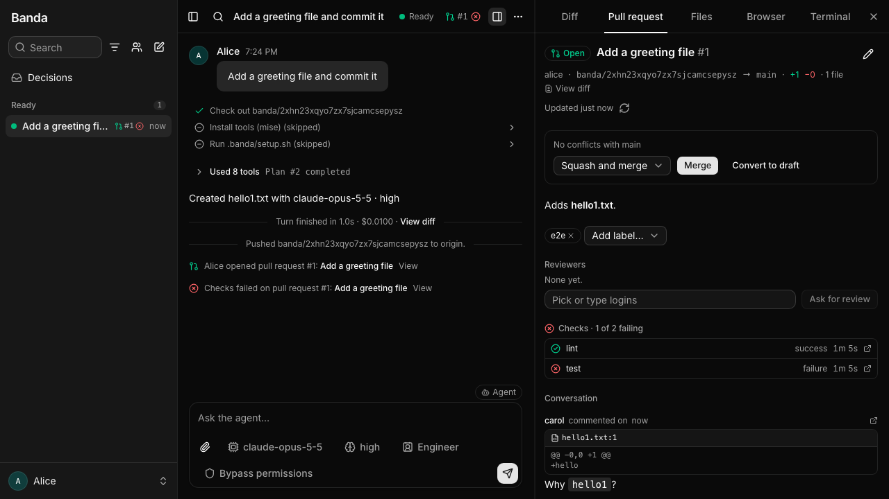

# Using Banda

How threads behave and how to prepare a repository for them. Settings are in [configuration.md](configuration.md).

## GitHub and GitLab

Once a thread's branch is pushed, its owner opens a pull request (GitLab: merge request) from the header, or links the one already open for the branch. Everyone then sees it in the thread: a chip with its state, checks, review and conflicts (also on sidebar rows and team board cards), a **Pull request** tab with the description, reviewers, checks, mergeability and the conversation, and a quiet line in the chat when it is opened, its checks fail, it is approved or changes are requested, merged or closed, which the agent also reads with its next prompt. A pull request the agent opens itself (with `gh` or `glab`) is linked by itself when its turn ends. The owner edits it, marks it draft or ready, asks for reviews and adds labels (picked from the repository's collaborators and labels) and merges it; anyone with a token of their own comments, replies and resolves review threads. With a token, the repository chip of a new thread also lists your repositories on the forge, filtered as you type and searched on the forge. Agents read it with the `read_pull_request` MCP tool and comment on their own thread's with `comment_pull_request`.

Banda acts with each person's own token, from their secrets in Settings (the same ones their threads get, so a personal secret beats a team one):

| Forge | Secret | Token |
|---|---|---|
| GitHub, GitHub Enterprise Server | `GIT_TOKEN` | Fine-grained: Contents read and write (pushes), Pull requests read and write (also labels and resolving review threads), Commit statuses read, Checks read (Actions read for workflow runs), Metadata read (collaborators, search). Classic: `repo`. |
| GitLab, self-hosted GitLab | `GITLAB_TOKEN`, else `GIT_TOKEN` | A personal access token with the `api` scope (`write_repository` alone pushes but can't open merge requests). |

github.com and gitlab.com are known; name self-hosted hosts in `FORGE_HOSTS`, e.g. `FORGE_HOSTS=git.corp.example=gitlab,ghe.corp.example=github`. The API polls linked pull requests every `PULL_REQUEST_POLL` (default `30s`) while someone has the thread open and ten times slower otherwise, with conditional requests on GitHub; no webhooks are needed. In the cluster the API needs `get` on Secrets in the sandbox namespace to read the tokens. Without a known forge or a token, the header links to GitHub's compare page instead.

## Permissions

The permission chip in the composer sets what the agent asks for in that thread: nothing (bypass, the default), edits and commands (ask), commands other than edits (accept edits), or everything until you approve its plan (plan). Requests appear in the chat; you answer them, or your teammates once you trust them. You can change a command or an edit before allowing it. "Always allow" applies to that tool, or to a narrower rule such as `npm test …` or edits in one directory, for the rest of the thread; the composer's "Allowed" chip lists them and takes them back. When the agent asks a question, everyone can vote on the options; your answer (or a trusted teammate's) is what it gets.

## Profiles

The profile chip in the composer sets who the agent works with in that thread: **Engineer** (Claude Code as it is, the default), **Specification** (talks through what you want in plain language and writes it up as a spec with you; once you confirm it, an Engineer sub-thread builds it, and the agent tells you what came of it), **DevOps** (explores and explains production with the credentials in your environment, read-only first, asking before any change) or **Business** (does business work for you, such as documents, data and automation, and shows results, not code). A profile changes how the agent talks and works with you, never what it may do. Settings sets the profile new threads start with; the owner switches it in a thread, applied once the agent's turns have ended. A sub-thread starts with its parent's; the spawn dialog's chip picks another.

## Work without a repository

For work without code, pick **No repository** in the composer's repository chip. The agent starts in an empty folder in the thread's environment; the Files tab and the terminal work on it, but there is no diff, push or pull request. The folder lives only in that environment, so settling the thread never deletes it. A fork gets the conversation but not the files, and sub-threads have no repository either.

## Preparing a repo

Before the agent starts, a thread installs the tools from the repo's `mise.toml`, `.mise.toml` or `.tool-versions` with [mise](https://mise.jdx.dev), then runs `.banda/setup.sh` with bash in the checkout (once per thread; again when the script changes; 15 min timeout). The chat shows each step. If one fails, the thread stops with its output; the terminal still works, and **Retry** runs the setup again.

`.banda/profiles/<name>.md` (`engineer`, `spec`, `devops` or `business`) replaces that profile's text in the agent's system prompt for the repo. It is read whenever the agent starts, so an edit applies from its next start (a resume, or a change of model, effort or profile).
